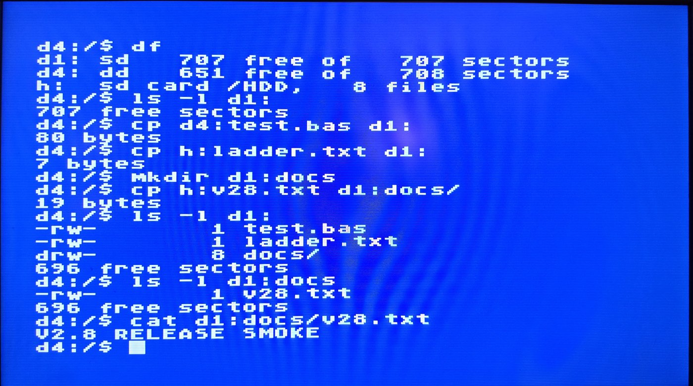
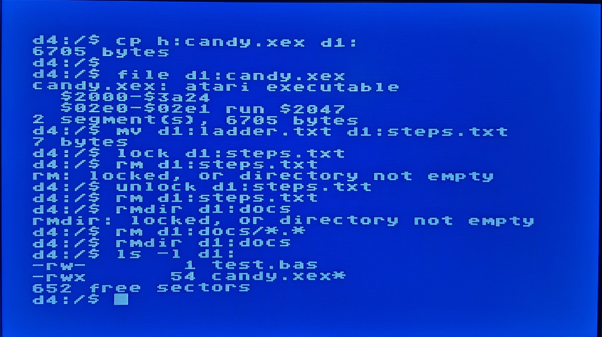

# ASH — the Atari SHell

A Unix-style command line for the Atari 8-bit (XL/XE, 64 KB) that replaces the
DOS menu: browse disks and launch `.xex` programs directly. No DOS is loaded —
ASH reads DOS 2.x / MyDOS directories and files sector by sector over SIO.

```
ASH 1.0 - the Atari SHell
d1:/$ ls
neondrop.xex* candy.xex*   readme.txt
d1:/$ file neondrop.xex
neondrop.xex: atari executable
  $2000-$3f75
  $4800-$5607
  $02e0-$02e1 run $2047
d1:/$ neondrop
loading neondrop.xex
```

<p align="center">
<br>
<em>Copying files between the hard drive (d4:), the SD card folder (h:) and a floppy, into a new directory.</em>
</p>
<p align="center">
<br>
<em>A game copied onto the disk and inspected with <code>file</code>; rename, lock, wildcard delete and rmdir.</em>
</p>

## Commands

| | |
|---|---|
| `ls [-l] [path]` | list (`*` = executable, `/` = MyDOS subdirectory; `-l` sizes + free sectors) |
| `cd path` / `d2:` / `h:` | change drive/dir: `d1:`–`d4:`, `h:`, `..`, `/`, `games/sub` |
| `pwd`, `cat`, `xxd`, `file` | where am I, show text (paged), hex dump, identify / list xex segments |
| `run file`, or just `name` | load and run; a bare name tries `name`, `.xex`, `.com`, `.exe` |
| `df` | drives present, density, free sectors; H: file count |
| `cp src dst` | copy between any disks and `h:`; `dst` may be a directory |
| `rm`, `mv` | delete (wildcards on disks), rename or move |
| `mkdir`, `rmdir` | MyDOS subdirectories |
| `lock`, `unlock` | write-protect files |
| `format dn:` | quick-format a disk as empty DOS 2 (asks first) |
| `edit file` | full-screen text editor (below) |
| `peek adr [len]`, `poke adr b..` | memory (hex) |
| `theme green\|amber\|blue\|white`, `history`, `clear`, `echo`, `basic`, `reboot`, `ver`, `help` | |

Line editor: TAB completes file names (lists choices when ambiguous), ↑/↓
recall the last 8 commands, Ctrl-U kills the line, Ctrl-L clears, BREAK
cancels. RESET at the prompt returns to ASH instantly.

Devices: `d1:`–`d4:` are any DOS 2.0/2.5/MyDOS disk (SD or DD, MyDOS
subdirectories and 16-bit sector links). `h:` is the Tang Nano board's SD
folder `/HDD` (SIO device $72) — so programs can be copied from the PC
(`atari.py send GAME.XEX HDD/GAME.XEX`) and run without making a disk.

## The editor

`edit FILE` opens (or creates) a text file, on a disk or on `h:`. Arrows
move, typing inserts, Backspace and Ctrl-Delete delete, Shift-Delete or
Ctrl-K kills a line, Tab indents to the next multiple of 4, Ctrl-A / Ctrl-E
go to the start / end of the line, **Ctrl-S saves, Ctrl-Q quits** (it warns
once if there are unsaved changes). Long lines scroll sideways. Files keep
their line-ending style: a Unix file stays Unix, new files use ATASCII.
16 KB of text.

## The D: device

ASH installs a read/write `D:` handler (`$0700-$1BFF`, below DOS 2.5's
MEMLO) that stays resident for BASIC and for launched programs: `OPEN`,
`LOAD`/`SAVE`, `LIST "D:X.LST"`, `ENTER`, XIO rename/delete/lock/unlock,
`XIO 42` mkdir and `XIO 254` quick-format all work, with wildcards and
`DIR>` / `DIR/` paths. Disks must be 720-sector DOS 2 format (SD or DD);
other layouts (big MyDOS, SpartaDOS) are readable but not writable. RESET
keeps `D:` alive.

Note: `.BAS` files written by BASIC's `SAVE` are tokenized, not text —
`cat` shows binary; use `LIST "D:NAME.LST"` for a text listing.

## ASH-TN: the Tang Nano 20K build

`make tn` builds `ash-tn.xex` (and `make release` adds `ASH-TN.XEX` /
`ASH-TN.ATR`): the same shell plus a page-6 **mailbox** (`$0640`, see
`tn.s`) through which the PC drives it over the board's PC link with no
keystroke injection, plus two commands: `pc` (is the PC program there? — if
not: *connect the board to the pc with the usb cable and run ashterm there*) and `getw` (used by `get`). The PC side, `ashterm.py`, lives in the board repo
(`tools/ashterm.py` in
[atari800_tang_nano20k](https://github.com/carlosbravoa/atari800_tang_nano20k),
next to `atari.py`), so one clone gives you the whole link:

```
python3 tools/ashterm.py                 # terminal: ASH's own prompt, exact output, Ctrl-C aborts
python3 tools/ashterm.py -c "ls -l" -c "cat readme.txt"
python3 tools/ashterm.py get d1:game.xex ~/game.xex   # any disk, h:, MyDOS subdir
python3 tools/ashterm.py put ~/game.xex d1:           # via h:, then cp
```
`ashterm` tells you what to check when it can't work: no board found on USB, board up but ASH-TN not running, or the shell busy in
a pager / the editor / a launched program. Protocol: the PC pokes a
command line and sets `MB_CMDREQ`; ASH runs it (echoed on the TV, never
paged), mirrors the output to `$6A00` with a running length, and reports
status 1 (ok) / 2 (error, with the code) / 3 (a program was launched).

### sd: — the whole SD card (needs the firmware's control XIOs)

With a firmware that implements the H: control XIOs (`specs/ash-tn-proposal.md`
in the parent repo, section 3), ASH-TN sees the card as `sd:`:

```
ls -l sd:/games            cd sd:/disks/dos           cat sd:/README.TXT
run "sd:/games/Candy Crunch.xex"   (quotes keep the spaces of long names)
cp sd:/games/x.xex d1:     mount                      mount d1: sd:/disks/x.atr
umount d1:                 cart sd:/carts/x.car       reboot
```
`sd:` is read-only from the shell (read, mount, boot); `mount`, `cart` and
`reboot` are acknowledged by the firmware and performed from its main loop a
moment later. Without the XIOs these commands report an I/O error.

### Network through the PC (`ashterm` running on the PC)

With `ashterm` connected, the shell can reach the internet via the PC: `date`
(the PC's clock, then kept by the Atari), `wget URL [dest|-]`, and `ls`,
`cat`, `run`, `cp` accept `http(s)://` and `tnfs://host/path` URLs, so a
FujiNet TNFS server browses like a disk and its programs run directly:

```
date                                  ls tnfs://tnfs.fujinet.online/ATARI
wget https://example.org/game.xex     run tnfs://tnfs.fujinet.online/ATARI/_lobby.xex
cp tnfs://host/games/x.atr sd:/disks/  (sd: needs `sd rw`)
```
The Atari never talks to the network: it posts a request in the mailbox,
`ashterm` fetches on the PC and delivers the file through the board's file
transfer (to the card, or into `/HDD` for the shell to copy on). Without a
PC: *no answer from the pc…*. Command lines are up to 111 characters, for
URLs.

### ASH.CAR: the shell as a cartridge

`make cart` packs ASH-TN into a Williams 32K cartridge image (`release/
ASH.CAR`): attach it (OSD → Cart) and the machine boots straight into the
shell, no disk needed; RESET after a game comes back to the prompt; the
cartridge switches itself off once the shell is in RAM, so `$A000-$BFFF`
is free for programs and `basic` / BASIC's `DOS` work as usual. Bank 0 is
`cart.s` (a copier parked in page 6 by the init vector, GINTLK-safe
switch-off), banks 1-2 carry the shell image, `k_cartreset` in the kernel
is the RESET hook. Verified on the board: boot, launch, warm reset, BASIC
round trip. Persistence across power cycles needs the firmware's `boot=`
/ default-cartridge setting (see `specs/ash-tn-proposal.md`).

## On a real Atari

Disk access is plain SIO through the OS, so any Atari drive or SIO2SD /
SDrive / FujiNet works, at standard speed. `h:` is the Tang Nano board's
SD-folder device; ASH probes it at boot and hides it when it isn't there.
Tested on the board's XL/XE (64 KB); a 400/800 should work but is untested.
Writable disks are 720-sector SD or DD; ED and big MyDOS disks are read-only.

## How it works

- `$2000-$55FF` shell, `$5600-$65FF` buffers, `$6600+` editor text / BASIC.
  BASIC is switched off (the `basic` command turns it back on).
- The resident kernel at `$0700-$1BFF` streams files (DOS 2 / MyDOS sector
  chains or `h:`), runs the XEX loader (INITAD / RUNAD, first-segment
  default) and holds the `D:` file manager with its buffers. That's inside
  DOS 2.5's own footprint, so anything that loads under DOS loads under
  ASH, and launched programs can use `D:`. After a launch RESET cold-boots.

## Building & using

```
make                                   # build/ash.xex, build/boot.bin
python3 tools/mkatr.py -o ASH.ATR --shell build/ash.xex --boot build/boot.bin \
        game1.xex "Long Name.xex=GAME2.XEX" readme.txt      # [--dd] for 180K
```
Boot `ASH.ATR` on D1: (OSD → D1: → Attach → Boot to OS), or load
`build/ash.xex` as an executable. `mkatr.py --list X.ATR` lists any DOS 2/MyDOS ATR.

Dev tools: `deploy.py` (inject into a running Atari over the PC link and
warm-start it), `tools/sh.py` (type commands, dump the screen),
`tools/emu.py` (py65 rig: CIO dispatched through HATABS so the real D:
handler runs, writable ATRs + H: folder served, `--esc` key scripts — runs
the boot path, listings, file ops, the editor and launches deterministically),
`tools/test_fms.py` (the D: handler through CIO, SD + DD, fsck after every
step), `mkatr.py --fsck DISK.ATR` (DOS 2 structure checker),
`tools/hwrun.sh` (launch `h:NAME` on hardware, liveness check).
